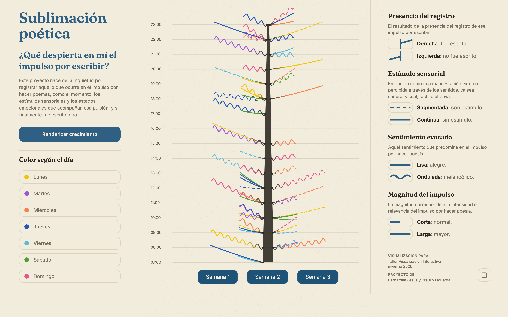

# Sublimación poética

**¿Qué despierta en mí el impulso por escribir?**

Este proyecto registra lo que ocurre en el impulso por hacer poemas: el momento, los estímulos sensoriales, los estados emocionales que lo acompañan y si finalmente fue escrito o no.

Taller Visualización Interactiva, invierno 2026 · Bernardita Jesús y Braulio Figueroa

## Cómo leerla

El **tronco** marca las horas del día (de 07:00 a 23:00) y cada **rama** es un impulso por escribir registrado durante tres semanas.

| Categoría | Significado |
|---|---|
| **Presencia del registro** | Derecha: fue escrito · Izquierda: no fue escrito |
| **Estímulo sensorial** | Segmentada: con estímulo · Continua: sin estímulo |
| **Sentimiento evocado** | Lisa: alegre · Ondulada: melancólico |
| **Magnitud del impulso** | Corta: normal · Larga: mayor |
| **Color** | Día de la semana (de lunes a domingo) |

Se puede filtrar haciendo clic en los días, en las categorías o en los botones de semana.
